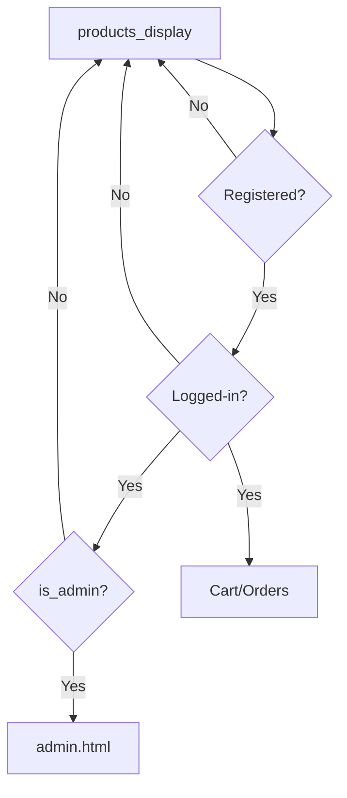
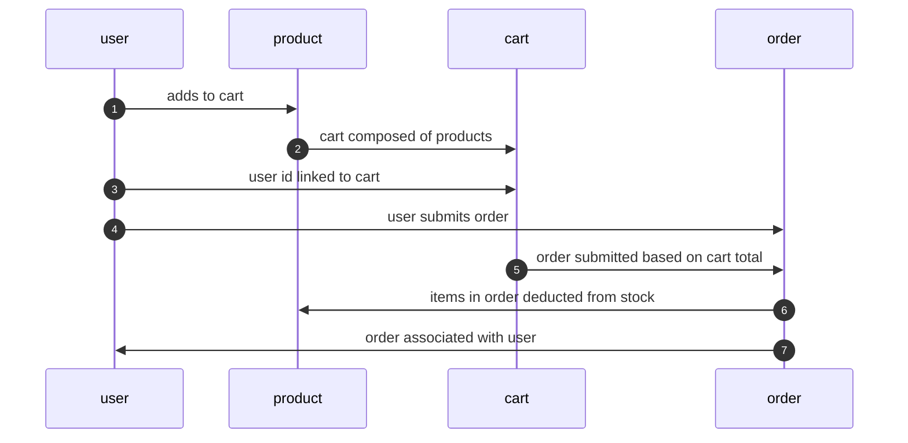

# COMPSCIX446 Course Project: ecommerce application

Last updated: 2026-October-26

Author: Christina Valen

# Table of Contents
* [Project Overview](#project-overview)
* [Application Features](#application-features)
* [Challenges Encountered](#challenges-encountered)
* [System Configuration](#system-configuration)
* [Testing and Debugging](#testing-and-debugging)

## Project Overview 
The ecommerce application presents a very simplified version of a website used to artificially handle orders complete with a shopping cart, orders page, the ability to handle account registration, login, and logout. The application connects an Amazon Aurora relational database with Python handling and a JavaScript/HTML frontend. Features and presentation are minimal. The application is by no means optimized and was developed for course practice.

To run: `python run.py`
Navigate to localhost:5000/products_display to view the landing page.
Dependencies can be found in requirements.txt.

## Application Features 
Core functionalities:
- User Management:
Users can register an email and password (that will be hashed) that will be an entry in a SQL table. Login requires valid values to be retrieved from this table. Invalid registration attempts including attempting to register a currently used email address and a blank password will result in an Invalid Registration message being displayed to the user. Login requires a valid entry for email and password otherwise a message will be displayed to the user. Upon successful login, a welcome message with the user's email will be displayed and a working logout button will be displayed.

- Restricted Access:
Attempting to access cart, orders, the admin page, or add an item to cart while not logged-in will result in an error message. If logged-in and the cart page is accessed without any items in cart, a message is displayed telling the user to go shopping. If logged-in and the orders page is accessed without any orders, a raw error is displayed. The user table contains a variable is_admin which cannot be set within the web application. If is_admin is 1 for the user, they will gain access to the admin portion of the application. If the user is not an admin such that is_admin is 0 for the user, they will be directed to a page informing them of unauthorized access.  

- Product Mangement: 
Items in the product database are automatically displayed on localhost:5000/products_display including the id number, name, description, price, and stock. The description, price, and stock can be edited from this page. Attempts to change the price and stock to non-number or negative values will result in an error message. Prices will be displayed with 2 decimal places for a numeric value. When an item is added to cart, a simple check is done to make sure that the user has not added more of that item's stock to their cart which will give an error message. When the user presses the Checkout button, the item's stock is decremented by the amount in the user's cart. Should one user check-out an item such that it becomes out-of-stock while another user still has it in cart, an error message will appear and that item will be deleted from the cart. If an item becomes out-of-stock, the add to cart button will no longer become available and will be replaced with the message that the item is no longer in stock.

- Shopping Cart:
When an item is added to cart, that item and the user id are added to a cart database. Accessing the shopping cart retrieves all associated entries and a total is calculated for the user. Clicking the remove item button will result in the entry being removed from the cart database and the page will reload to update the total. Upon clicking checkout, entries will be removed from the carts database and an order will be created with the total and user id. The user's cart will be empty.

- Orders:
Accessing the orders page gives a very simple page with associated entries in the orders database.

## Challenges Encountered 

### Limitations

Little thought was put into table structure ahead of time resulting in redundant and unused information within tables. Particularly egregious is the lack of an ability to change quantities of products to be added to cart. Items must be added to cart one-by-one which is inefficient and unrealistic, but reasonable for a student project. 

The entries from cart are deleted and a total is only included in the orders database resulting in no way to know which products are actually being ordered.

Registration and login also have their issues. Registration does not verify that the email address entered in is a valid email aside from checking that an '@' is present and has an arbitrary length greater than 3. Passwords do not have any requirements aside from being non-empty mainly to use a simple password for testing. 

Unsuccessful logins will not indicate if the problem entry is the email or password. There is no way to retrieve a forgotten password or reset a password.

The carts database is horribly inefficient and would likely bloat and cause memory issues in any actual use-case.

Most obviously, as this is intended to be a toy application, there is no payment handling and address information is not requested at any point from the user.

The Admin page contains only the option to update "product" information and not the options to delete or add new products. Products must be entered or deleted from the sql database. Updating does not include the option to change the product name. In the carts database, the product name is used as a foreign key instead of the product id such that the product name should not be changed easily for the sake of orders.

The metrics page is also accessible to all users.

## System Configuration 
User Handling:

### Frontend
Within app/templates are the following html files:
- admin.html: access to product update form. Only available if user is defined as an admin in the user SQL database. Checks that price and stock are positive numbers before making changes.
- not_admin.html: non-admin users attempting to access the admin page will be redirected here.
- orders.html: a simple page that displays all "orders" associated with user.
- products.py: the landing page for the application. Displays all associated products with the option to add to cart. Email and password input boxes along with buttons to register and login with the information in those boxes are present. Upon login, a logout button becomes available.
- shopping_cart.py: displays associated items in user's cart. Each item has a remove item button that will remove the item from the cart. Checkout button will create an order.

### Backend
#### Associated SQL Databases
The ecommerce.sql database contains tables:
- carts
    - id
    - user_id
    - product_name
    - price
    - quantity
- orders
    - order_id
    - user_id
    - total
    - order_time
- product
    - id
    - name
    - description
    - price
    - stock
    - image_url
    - created_at
- user
    - id
    - email
    - password_hash
    - is_admin

#### Python & Route Handling
Within app/models.py, linking between the values of the various SQL tables and associated variables used in the methods found in routes. Within app/routes are the following files:

- auth.py: handles user registation, login, logout, and access to admin page.   
- cart.py: handles cart fetching and deleting an item from cart.
- metrics.py: website metrics available at localhost:5000/metrics using prometheus.
- orders.py: adding all items in a user's cart and total to the orders database; removes items from carts database when order is successful. Cancelling order and removing item from cart if amount in cart exceeds available stock. Also renders order information for display at localhost:5000/orders.
- products.py: handles adding a product to a user's cart, retrieving available products, and updating of a product's characteristics. Functions for adding and deleting products to the products database exist, but are not used.

### AWS integration
AWS is incorporated through the previously mentioned SQL tables and an EC2 bucket hosting the pngs referenced by the SQL instance.

### Security Measures

Passwords are hashed before storing in the sql database. Basic logging of unauthorized attempts to access admin and runtime of carts are implemented through prometheus.

## Testing and Debugging 
Testing was done in an ad hoc basis. 

Forms are minimal in the application present in the user authentication area and admin section. Some validation takes place to avoid null entries and values that are unreasonable such as negative or non-numeric entries for number fields.

Testing also included accessing areas while in various states of user authorization including not logged in, logged in as a non-admin, and logged in as an admin. Routes are blocked or the user is redirected as appropriate.

Effort was also placed in avoiding the user adding an out-of-stock item to cart or attempting to submit an order with an out-of-stock item in cart. The user's cart will be updated or the product display will be edited to avoid this happening.

Error handling was typically handled in a redundant fashion with value checks in Javascript and HTML and checks within the routing functions before committing changes. 